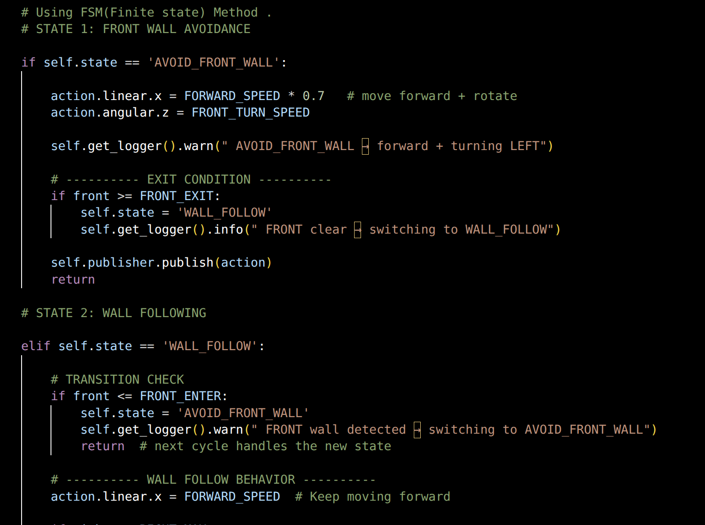
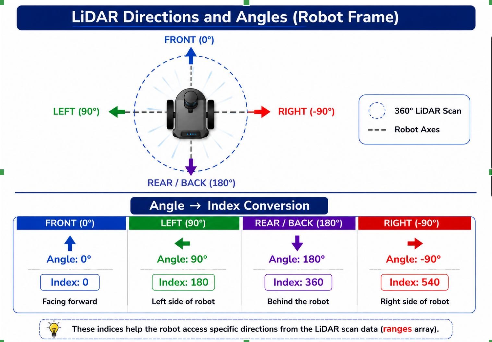
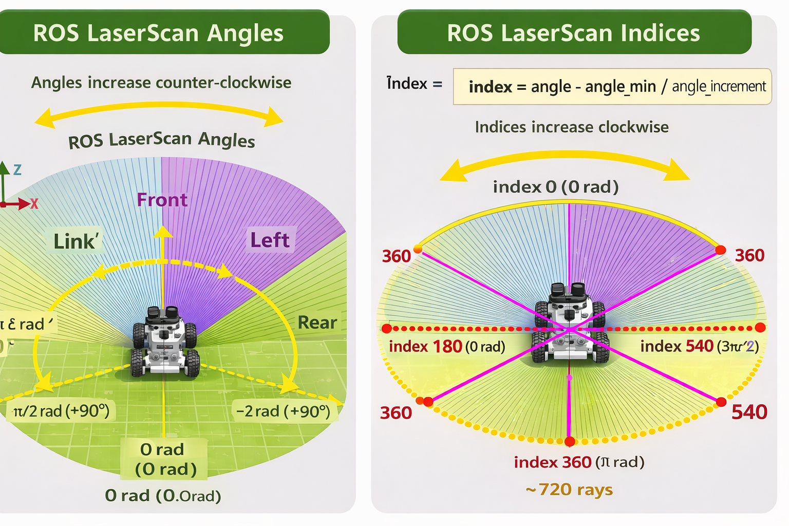

# Autonomous Wall Following Robot using ROS 2 and LiDAR

An autonomous wall-finding and wall-following robot developed using ROS 2, Python, and LiDAR-based perception. The project combines a Finite State Machine (FSM), hysteresis-based state transitions, sector-based LiDAR processing, and proportional control to achieve structured wall-following behaviour.

The project was tested in simulation and on a real robot using The Construct Remote Robotics Lab.

## Overview

The robot autonomously:

1. Detects the nearest wall using LiDAR.
2. Rotates towards the detected wall.
3. Aligns itself using LiDAR-based symmetry correction.
4. Approaches the wall while maintaining a safe distance.
5. Aligns parallel to the wall.
6. Follows the wall while responding to obstacles in front of it.

The project explores practical challenges in robotic perception and reactive control, including noisy sensor measurements, circular LiDAR scan indexing, controller oscillations, and responsive ROS 2 action handling.

## Demo

### Wall-Following Demonstration

[Watch the wall-following demonstration](assets/Screencast%20from%202026-10-11%2021-07-58.webm)

### Screenshots

The following screenshots illustrate the robot and its wall-following behaviour.


## Features

- **Autonomous wall finding:** Detects and approaches the nearest wall.
- **FSM-based behaviour:** Organises wall finding and alignment into distinct states.
- **LiDAR-based perception:** Uses `sensor_msgs/LaserScan` measurements to understand the surrounding environment.
- **Sector-based LiDAR processing:** Uses groups of scan measurements rather than relying exclusively on individual rays.
- **Wrap-aware scan processing:** Handles angular sectors crossing the circular 0°/360° scan boundary.
- **Hysteresis-based transitions:** Helps prevent unstable switching between behavioural states.
- **Proportional obstacle avoidance:** Adjusts the turning response based on front obstacle distance.
- **ROS 2 services and actions:** Supports communication between the robot behaviours and reusable interfaces.
- **Odometry recording:** Records odometry data through a ROS 2 action.
- **Simulation and real-robot testing:** Tested in simulation and through The Construct Remote Robotics Lab.

## Project Architecture

The project is organised as a single ROS 2 Python package.

### Main Nodes

| Node | Purpose |
|---|---|
| `wall_finder.py` | Detects the nearest wall and manages the wall-finding and alignment sequence. |
| `wall_following_basic.py` | Implements basic wall following using an FSM and hysteresis, without the proportional obstacle-avoidance controller. |
| `wall_following.py` | Implements the advanced wall-following behaviour, combining FSM logic, hysteresis, and proportional front-obstacle avoidance. |
| `odom_recorder.py` | Records odometry data using a ROS 2 action. |

### Finite State Machine

The wall-finding behaviour uses a Finite State Machine (FSM) to organise the robot's actions into explicit states.

The states are:

- `FIND_NEAREST_WALL`
- `ALIGN_TO_WALL`
- `MOVE_WALL`
- `ALIGN_RIGHT`
- `DONE`

This structure separates the wall-finding process into manageable stages and makes the robot's behaviour easier to understand and debug.



### Hybrid Controller Architecture

The advanced wall-following controller combines multiple techniques:

- **Finite State Machine:** Organises the robot's behavioural states.
- **Hysteresis:** Helps stabilise transitions between states.
- **Threshold-based wall following:** Provides the basic wall-distance response.
- **Proportional front-obstacle control:** Adjusts the turning response according to the measured obstacle distance.

This hybrid approach combines structured behavioural control with a distance-dependent response to obstacles in front of the robot.

## LiDAR Processing

LiDAR processing is central to both wall finding and wall following.

The project uses sector-based analysis to reduce the instability that can arise when relying on individual scan measurements. It also handles the circular structure of LiDAR scans, where angular sectors can cross the 0°/360° boundary.

### Understanding LiDAR Angles and Indices

A LiDAR message contains an array of range measurements. Each measurement corresponds to an angle determined by the scan's angular metadata.

Correctly mapping angles to array indices is important when extracting measurements in a particular direction.



### Understanding LiDAR Scan Structure

The scan array represents measurements across the sensor's field of view. Understanding its structure helps prevent indexing errors when selecting angular regions.



### Sector-Based Processing

Instead of relying only on individual rays, the project analyses groups of measurements within angular sectors.

This helps address situations in which a single measurement is noisy or does not adequately represent the surrounding wall or obstacle.

Wrap-aware slicing ensures that sectors crossing the circular scan boundary are processed correctly.

## Challenges and Solutions

### 1. Oscillations During Wall Following

**Challenge:** Using individual LiDAR rays made the robot's response sensitive to variations in individual measurements, causing unstable behaviour.

**Solution:** Introduced sector-based LiDAR processing to obtain more robust obstacle-distance estimates.

### 2. LiDAR Wrap-Around Issues

**Challenge:** Angular sectors near the front of the robot could cross the circular boundary between 0° and 360°. Treating the scan as a simple linear range could produce incorrect sector selections.

**Solution:** Implemented wrap-aware slicing to handle angular sectors that cross the scan boundary.

### 3. Blocking Action-Server Callback

**Challenge:** The initial odometry-recording implementation could block execution while processing the action.

**Solution:** Refined the execution approach using ROS 2 timers and `rclpy.spin_once()` to help keep callbacks responsive.

### 4. Oscillations During Front-Obstacle Avoidance

**Challenge:** Fixed turning speeds could produce abrupt responses when the robot encountered obstacles in front of it.

**Solution:** Introduced proportional control for front-obstacle avoidance while retaining threshold-based wall following for the main behaviour.

### 5. Callback Execution and Concurrency Issues

**Challenge:** During extended wall-following runs, the robot gradually deviated from its intended path. Investigation revealed that the execution of callbacks associated with wall-following and wall-finding behaviour was affecting the robot's control response.

**Solution:** After investigating ROS 2 callback execution and executor behaviour, the implementation was updated to use a `MultiThreadedExecutor`. This allowed eligible callbacks to execute concurrently, improving responsiveness and resolving the observed behaviour.

**Key takeaway:** In ROS 2, callback execution depends on the executor, callback groups, and how callbacks are scheduled. A multi-threaded executor alone does not guarantee concurrent execution of every callback; callback groups and shared-state access must also be configured appropriately.

## Technologies Used

- ROS 2 Humble
- Python
- `rclpy`
- `sensor_msgs/LaserScan`
- `geometry_msgs`
- `nav_msgs/Odometry`
- ROS 2 services and actions
- TurtleBot3
- Gazebo or another compatible robot simulation
- Ubuntu Linux
- The Construct Remote Robotics Lab

## Installation and Getting Started

This section describes how to build and run the project in a ROS 2 workspace.

### Prerequisites

Before starting, ensure you have:

- Ubuntu with ROS 2 Humble installed, or a compatible environment.
- Python and the required ROS 2 development tools.
- A compatible TurtleBot3 simulation or physical robot.
- A LiDAR publisher providing the scan data expected by the project.
- The `custom_interfaces` and `lidar_utils` dependencies.
- A compatible robot configuration with the required topics, services, actions, and TF frames.

**Important:** The `main.launch.py` launch file starts the project's ROS 2 nodes. It does not launch the robot simulation or configure the entire robot environment for you.

### Step 1: Obtain the Repositories

Clone the Wall Follower package and its dependencies into the `src` directory of a ROS 2 workspace.

You can use an existing workspace or create a dedicated workspace for this project.

#### Option A: Use an Existing ROS 2 Workspace

Navigate to your existing workspace's `src` directory. For example:

```bash
cd ~/ros2_ws/src
```

Clone the three repositories:

```bash
git clone <WALL_FOLLOWER_REPOSITORY_URL>
git clone <CUSTOM_INTERFACES_REPOSITORY_URL>
git clone <LIDAR_UTILS_REPOSITORY_URL>
```

Replace the placeholders with the actual GitHub repository URLs.

#### Option B: Create a Dedicated Workspace

If you prefer to keep this project separate from your other ROS 2 projects, create a new workspace:

```bash
mkdir -p ~/wall_follower_ws/src
cd ~/wall_follower_ws/src
```

Clone the same three repositories:

```bash
git clone <WALL_FOLLOWER_REPOSITORY_URL>
git clone <CUSTOM_INTERFACES_REPOSITORY_URL>
git clone <LIDAR_UTILS_REPOSITORY_URL>
```

Both approaches are valid. Choose the one that best fits your development environment.

The `custom_interfaces` repository provides the custom ROS 2 service and action interfaces used by the project. The `lidar_utils` repository provides reusable LiDAR processing utilities.

Ensure that all three ROS 2 packages are discoverable by `colcon` under your workspace's `src` directory. The exact directory layout depends on how the dependency repositories are organised.

### Step 2: Build the Workspace

Navigate to the root directory of the workspace you chose.

For an existing workspace:

```bash
cd ~/ros2_ws
```

For the dedicated workspace:

```bash
cd ~/wall_follower_ws
```

Source ROS 2 Humble:

```bash
source /opt/ros/humble/setup.bash
```

Build the workspace:

```bash
colcon build --symlink-install
```

After the build completes successfully, source the workspace:

```bash
source install/setup.bash
```

Verify that ROS 2 can discover the Wall Follower package:

```bash
ros2 pkg prefix wall_follower_turtlebot
```

If the build fails, check the terminal output for missing dependencies, package-discovery issues, or interface-generation errors before proceeding.

**Note:** Building the entire workspace may also build other packages already present in it. This is normal. You can use a targeted build command if you prefer to build only the packages required for this project.

### Step 3: Start the Robot or Simulation

Open **Terminal 1**.

Start your compatible TurtleBot3 simulation or bring up your physical robot using the instructions appropriate for that environment.

Before continuing, verify that:

- The robot is running.
- The expected LiDAR topic is available.
- The robot publishes the odometry required by the project.
- The required ROS 2 services, actions, and TF configuration are available.
- The robot can receive velocity commands from the controller.

For example, inspect the available topics:

```bash
ros2 topic list
```

Inspect the available services and actions if necessary:

```bash
ros2 service list
ros2 action list
```

The exact topic names and robot configuration depend on the simulation or hardware setup being used.

### Step 4: Launch the Wall-Following Nodes

Open **Terminal 2**.

Source ROS 2 and your chosen workspace.

For an existing workspace:

```bash
source /opt/ros/humble/setup.bash
source ~/ros2_ws/install/setup.bash
```

For the dedicated workspace:

```bash
source /opt/ros/humble/setup.bash
source ~/wall_follower_ws/install/setup.bash
```

Launch the project:

```bash
ros2 launch wall_follower_turtlebot main.launch.py
```

This launch file starts the project's configured wall-finding, wall-following, and odometry-recording nodes.

Keep the terminal open so you can monitor their output.

### Step 5: Observe and Debug

Monitor the robot's behaviour in the simulation or on the physical robot.

Check whether it:

1. Detects the nearest wall.
2. Rotates and aligns towards the wall.
3. Approaches the wall.
4. Begins following the wall.
5. Responds to obstacles in front of it.
6. Records odometry as expected.

If the robot does not behave as expected, check the LiDAR readings, topic names, service and action availability, TF configuration, and controller parameters.

**Safety note:** Test in a controlled environment with sufficient clearance. Keep access to a stop mechanism and do not assume that reactive wall following guarantees collision-free navigation.

## Real-Robot Testing

The project was tested on a real robot using The Construct Remote Robotics Lab.

The testing covered:

- Wall finding
- Wall alignment
- Wall following
- Front-obstacle handling
- Odometry recording

Real-robot testing required additional tuning compared with simulation because sensor noise, wall-loss conditions, and motion smoothness affect the controller's behaviour.

## Learning Outcomes

Developing this project provided practical experience with:

- ROS 2 node development using Python and `rclpy`
- Publishers and subscribers
- ROS 2 services and actions
- Custom ROS 2 interfaces
- FSM-based robot behaviour
- LiDAR geometry and scan processing
- Sector-based obstacle-distance estimation
- Circular scan indexing
- Hysteresis-based state transitions
- Proportional reactive control
- Odometry recording
- Simulation-to-real-world testing
- Debugging and tuning robotic behaviours

## Future Improvements

Potential directions for further development include:

- **Camera-based perception:** Incorporate visual information to complement LiDAR measurements.
- **Computer vision-based obstacle avoidance:** Investigate visual obstacle detection and use the resulting information in the robot's decision-making pipeline.
- **Sensor fusion:** Combine LiDAR and camera information to improve environmental understanding.
- **Adaptive control:** Explore dynamic velocity tuning and adaptive wall-distance control.
- **SLAM integration:** Extend the project towards mapping and localisation.
- **RViz visualisation:** Visualise LiDAR sectors, robot behaviour, and relevant debugging information.

These are planned extensions rather than features of the current implementation.

## Attribution

This project was developed through practical ROS 2 robotics work and testing, including the use of The Construct Remote Robotics Lab.

The project builds on concepts and tools from the ROS 2 ecosystem. Where source material, tutorials, or external resources have been used, the corresponding attribution should be retained.

## Author

Navjot Singh
